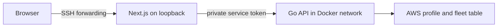

# Standalone browser companion

The desktopctl companion app runs on an operator-controlled server and shows the
same DynamoDB fleet as the CLI. It is an optional browser interface, separate
from the Orchael Desktops SaaS. It uses the operator's desktopctl config and AWS
profile. Google login, PostgreSQL, organizations, and Kubernetes are not
required.



## Run on a server

The server needs Docker with Compose, a desktopctl source checkout, a working
`~/.config/desktopctl/config.yaml`, and the AWS profile already used by the
CLI in `~/.aws`. The server must be able to read the fleet DynamoDB table and
perform the AWS and Pulumi operations you use. Run the command **on that server**:

```bash
desktopctl app start --source /path/to/desktopctl
desktopctl app status --source /path/to/desktopctl
```

`start` builds the web and API images from the checkout and waits for their
health checks. The API image contains the desktopctl CLI, Go runtime, and a
pinned Pulumi CLI. The checkout is mounted into the API container so the CLI
can run its Pulumi programs. The server's `~/.pulumi` directory is mounted for
provider plugins and local Pulumi settings. `start` creates a random, private
service token at `~/.config/desktopctl/app-api-token`. The Go API is reachable
only inside the Compose network. By default, the browser app binds to
`127.0.0.1:3000`.

If the desktopctl config names an SSH key, `start` reads its `.pub` file and
passes only that public key into the API container. The private key stays on
the server. The source checkout is mounted writable because Pulumi writes
stack settings there.

From your workstation, forward the private port with SSH:

```bash
ssh -L 3000:127.0.0.1:3000 user@your-server
```

Then open `http://127.0.0.1:3000/` in a browser. The SSH connection protects
the URL. Keep the tunnel open while using the app. To use a private HTTPS
network URL instead, configure an authenticated private network proxy to
forward to `127.0.0.1:3000`, and start the app with
`--origin https://your-private-host`. The app allows browser actions only from
that exact origin. Do not publish the port directly or use an unauthenticated
public reverse proxy. Browser access inherits the access policy of SSH or the
private proxy.

Set `app.bind` in the desktopctl config to bind a specific private server IP:

```yaml
app:
  bind: 192.168.1.20
```

`desktopctl app start --bind 192.168.1.20` overrides the config. The bind
address must be an IPv4 address assigned to the server, or `0.0.0.0` to listen
on every IPv4 interface. Selecting `0.0.0.0` prints an exposure warning;
restrict access with the server firewall and private network. The app has no
browser login. For a private DNS name and HTTPS, use the authenticated proxy
and `--origin`. When bound to `0.0.0.0`, replace that address with the server's
private IP to open the app in a browser.

Stop the app with:

```bash
desktopctl app stop --source /path/to/desktopctl
```

Pass `--config /path/to/config.yaml` to use a non-default desktopctl config.
The global `--profile` and `--region` flags override the configured AWS
profile and region for the app, as they do for CLI commands.
Pass `--port 3001` if port 3000 is occupied, and use the same port when
forwarding. `desktopctl app url` prints the browser URL; pass `--origin` to
print a private proxy URL.

## What the app manages

The fleet page lists records from the configured desktopctl DynamoDB table,
including CLI-created desktops with no organization ID. It shows lifecycle
state and location. Click a row to open its detail page, which shows every
available field on the fleet record. **Open desktop** uses that record's exact
HTTPS noVNC URL. Browser actions
create, start, stop, refresh, and terminate desktops. Create, start, stop, and
terminate run the matching desktopctl CLI commands in a serialized server job
queue. This preserves the CLI's provisioning, bootstrap, readiness, and
cleanup behavior. The browser polls job status; closing the page does not stop
an active job. Temporary status failures are retried. If tracking remains
unavailable, the page keeps the job ID and blocks new actions until you retry
tracking or explicitly refresh the fleet and clear tracking. Refresh reads live
instance state through the private API. Selecting a fleet row shows its summary
and lifecycle actions in the side panel; the details icon opens the full record.
**Open desktop** asks the running desktop for a fresh, one-session noVNC access
link over SSH. The stored `novnc_url` is only the base address and does not
contain an access token. Configure `desktop.ssh_key_path` with a key that can
reach the desktop; `app start` mounts that key read-only into the API container.
Create requests save a retry key in the browser before submission. If the
response is lost, use **Retry create request**; the server returns the same
job and desktop ID for that key while it is running, and retries after an API
restart retain the same desktop ID.
For create requests with repositories, the server checks public repositories
over anonymous HTTPS. Private repositories are checked with the configured
GitHub token from AWS Secrets Manager; the container does not need the host's
GitHub SSH key.
Termination requires typing the desktop ID. Wait for active jobs to finish
before stopping or upgrading the app; an interrupted CLI process may need
reconciliation with `desktopctl status` or `desktopctl terminate` on the server.
The companion app has no tenant database or SaaS account.

## Local development

Run `make dev-up` from the repository root to start the app with a mock fleet
and mock AWS. Open `http://127.0.0.1:3000/`. Run `make dev-down` to stop it.
The development service token is fixed for local mock mode only.

## Troubleshooting

- If `start` cannot find the Compose file, point `--source` at a full checkout
  of this repository.
- If it cannot find the config or AWS directory, configure the CLI on the
  server first. The container mounts those files read-only and runs as the
  invoking user so private AWS profile files remain readable.
- If the fleet is empty, check the configured environment, region, and fleet
  table against `desktopctl list` on the same server.
- If the page returns a fleet error, check `desktopctl app status` and
  `docker compose -f /path/to/desktopctl/deploy/control-plane/standalone-compose.yml logs api`.
- If the URL is unreachable from a workstation, keep the SSH tunnel open and
  verify the forwarded port matches `desktopctl app url`.

## Architecture and limits

The Next.js server holds the private API token and forwards `/api/fleet/*`
requests to the Go API. Browsers never receive AWS credentials or the service
token. The Go API uses the configured AWS profile directly in standalone mode.
Jobs are kept in API memory; if the API container restarts, the browser can
refresh the fleet to reconcile the last result. Job responses contain generic
failure messages so CLI diagnostics cannot leak secrets through the browser.
Server logs associate failed jobs with a bounded, filtered diagnostic. A timed
out lifecycle command and its child processes are stopped together; inspect
the fleet record before retrying an interrupted operation.
The old DOKS bootstrap IAM role is not needed for this mode. The old Helm,
PostgreSQL, and Nginx deployment files were retired.
Existing records remain in DynamoDB when the app stops; `stop` only shuts down
the companion containers.
